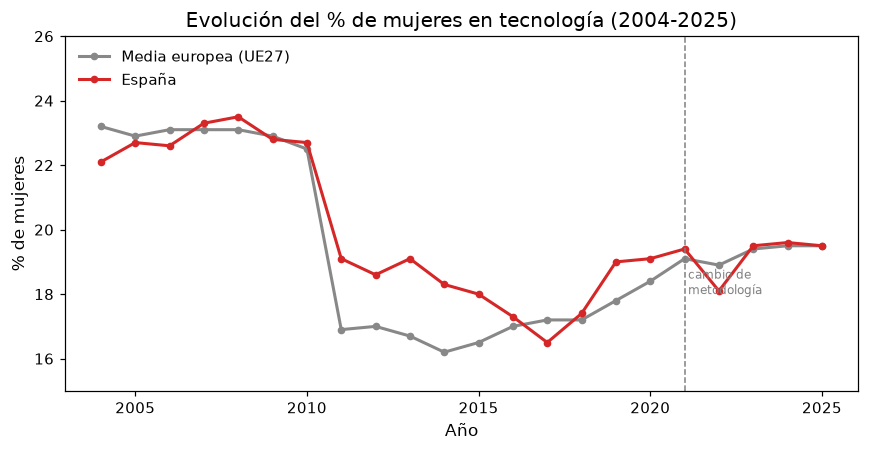
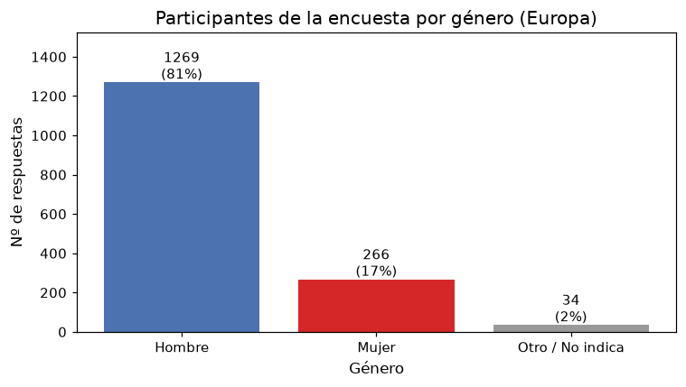
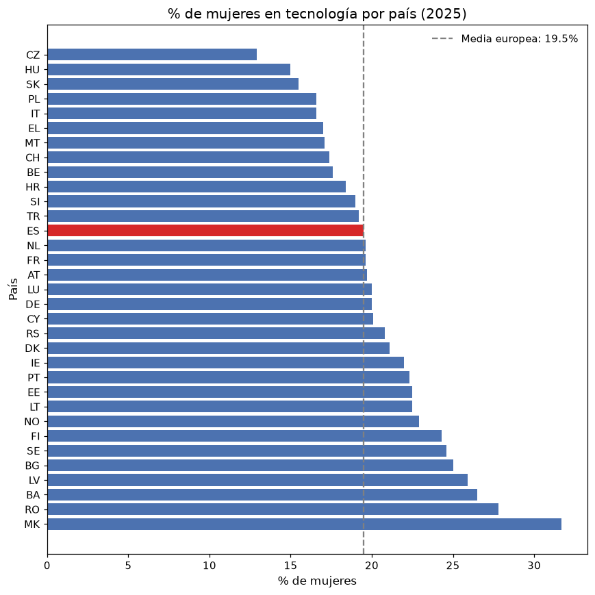

# Informe ejecutivo: Mujeres en el sector tecnológico en Europa

**Para:** Dirección (CEO)
**Asunto:** ¿Cuántas mujeres trabajan en tecnología y qué está pasando con su presencia?
**Fecha:** 9 de noviembre de 2026

---

## La conclusión en una frase

**En España, solo 2 de cada 10 especialistas en tecnología son mujeres, y ese número no ha mejorado en los últimos 20 años.**

---

## Qué hemos analizado

Hemos revisado dos fuentes independientes:

- **Datos oficiales de Eurostat**, que miden cuántas personas trabajan en el sector de la tecnología (especialistas TIC) y cuántas de ellas son mujeres, por país y por año (2004-2025).
- **Una encuesta internacional de profesionales del sector** (Kaggle), con respuestas de miles de personas sobre su género, edad, país, experiencia, cargo y salario.

Con esto respondemos a una pregunta sencilla: **¿cuál es la situación de las mujeres en el sector tecnológico europeo, y España en particular?**

---

## Hallazgo 1 — España está estancada en la media europea

- En 2004, el **22,1%** de los especialistas en tecnología eran mujeres. En 2025 son el **19,5%**.
- Es decir, **la proporción no ha mejorado en dos décadas**; de hecho, ha bajado ligeramente.
- España se sitúa **exactamente en la media europea** (19,5%), en el puesto 21 de 33 países.

**En lenguaje llano:** España no destaca ni para bien ni para mal. Estamos donde estábamos hace 20 años.

---

## Hallazgo 2 — Las mujeres son una minoría clara en el sector

- En la encuesta, **8 de cada 10 participantes son hombres**; solo **17%** son mujeres.
- La encuesta es voluntaria, así que no es una foto perfecta, pero coincide con los datos oficiales: la presencia femenina ronda el 20%.

**En lenguaje llano:** por cada mujer en tecnología, hay entre 4 y 5 hombres.

---

## Hallazgo 3 — Las pocas mujeres que hay se concentran en datos y gestión, no en programación

Mirando a las personas que llevan poco tiempo en el sector (juniors):

- Las mujeres están relativamente más presentes en **análisis de datos** (30%), **gestión** (26%) y **ciencia de datos** (30%).
- En **ingeniería de software**, apenas hay mujeres: **solo el 8%**.

**En lenguaje llano:** las mujeres que entran al sector se van hacia los perfiles de análisis y gestión, y casi no aparecen en los puestos de programación.

---

## Hallazgo 4 — No encontramos una brecha salarial clara (pero la muestra es pequeña)

Entre las personas con poca experiencia (juniors):

- La **mediana salarial es idéntica** para hombres y mujeres: **35.000 USD al año**.
- El salario *medio* sí es algo menor para las mujeres, pero esa diferencia la arrastran unos pocos hombres con sueldos muy altos, no la mayoría.

**En lenguaje llano:** con los datos que tenemos, no podemos afirmar que las mujeres junior cobren menos. Tampoco podemos descartarlo, porque hay muy pocas mujeres con salario declarado (39).

---

## El patrón que más llama la atención

En los países del este de Europa hay **más** mujeres en tecnología que en el oeste:

- **Bulgaria (29%), Rumanía (28%), Letonia (26%)**, frente a **Chequia (13%), Hungría (15%), Italia (17%)**.
- España (19,5%) queda en medio.

Esto sugiere que la presencia femenina no depende solo de la economía del país, sino de factores históricos y culturales. Vale la pena estudiarlo para aprender de esos países.

---

## Qué NO nos dice este análisis (limitaciones)

- Medimos **cuántas mujeres ya trabajan** en el sector, no cuántas se **contratan**. Son cosas distintas.
- La encuesta es **voluntaria** (solo responde quien quiere), así que puede estar sesgada.
- Para el análisis de salario y de cargo, la **muestra es muy pequeña** (pocas mujeres respondieron).
- En 2021 Eurostat **cambió su forma de medir**, así que hay que mirar con cuidado las comparaciones antes/después de ese año.

---

## Recomendación

1. **Estudiar los países del este de Europa** para entender por qué tienen más mujeres en tecnología y si se puede replicar.
2. **Conseguir datos de contratación** (ofertas, candidatas) para saber si el problema está en la entrada al sector o en la permanencia.
3. **No asumir brecha salarial sin más datos**: la muestra actual es demasiado pequeña para afirmarlo.

---

*Informe elaborado a partir del análisis exploratorio de datos del repositorio. Los gráficos proceden del notebook `notebooks/eda_mujeres_tech.ipynb`.*
